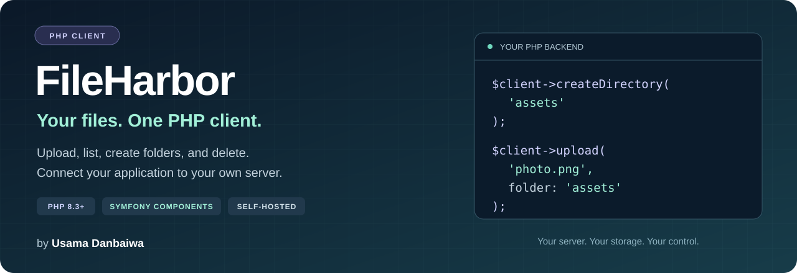
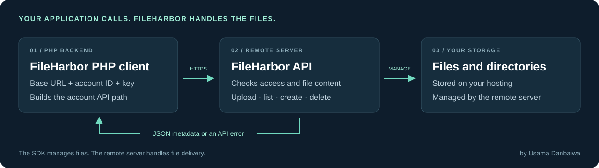
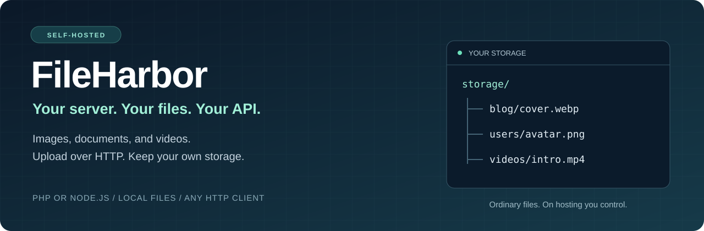

# FileHarbor PHP client



<p align="center">
  <a href="https://github.com/usamadanbaiwa/fileharbor-php-client/stargazers"></a>
  <a href="https://github.com/usamadanbaiwa/fileharbor-php-client/forks"></a>
  <a href="docs/getting-started.md"></a>
  <a href="docs/symfony.md"></a>
  <a href="https://packagist.org/packages/fileharbor/client"></a>
  <a href="LICENSE"></a>
</p>

<p align="center">
  <strong>Upload files. Manage folders. Keep control of your storage.</strong><br>
  A PHP client for your self-hosted FileHarbor server.<br>
  Built by <a href="https://github.com/usamadanbaiwa">Usama Danbaiwa</a>.
</p>

<p align="center">
  <a href="#installation"><strong>Install</strong></a> ·
  <a href="#quick-start">Quick start</a> ·
  <a href="#how-it-works">How it works</a> ·
  <a href="docs/README.md">Documentation</a> ·
  <a href="CONTRIBUTING.md">Contribute</a>
</p>

A backend SDK for the [FileHarbor](https://github.com/usamadanbaiwa/FileHarbor) HTTP API. Works with either the PHP or Node.js server. Requires PHP 8.3+ and JSON. Uses Symfony HttpClient for HTTP requests and Symfony Mime for multipart forms and file MIME headers. cURL is optional; Symfony can also use PHP streams.

Upload files, browse folders, and manage files through a small PHP API. Your application keeps its own file records; FileHarbor stores and serves the files.

## How it works



Give the client your server's base URL, account ID, and API key. It constructs the account API route and sends management requests. FileHarbor validates each request, manages the files, and returns metadata to your application.

| Task | Client method |
| --- | --- |
| Upload a local file | `upload()` |
| Browse files and folders | `listFiles()` |
| Create or browse directories | `createDirectory()`, `listDirectories()` |
| Delete an exact file or directory | `deleteFile()`, `deleteDirectory()` |

## Documentation

- [Getting started](docs/getting-started.md): requirements, installation, credentials, and your first upload.
- [Working with files](docs/usage.md): uploads, pagination, directory management, and deletion.
- [API reference](docs/api.md): constructor options, methods, response fields, and permissions.
- [Symfony integration](docs/symfony.md): service configuration and HTTP client injection.
- [Errors and troubleshooting](docs/errors.md): error codes, timeouts, and common setup problems.
- [Examples](examples/README.md), [contributing](CONTRIBUTING.md), [security policy](SECURITY.md), and [changelog](CHANGELOG.md).

See the [documentation index](docs/README.md) for a suggested reading order.

## Installation

Install the package from Packagist inside your application:

```sh
composer require fileharbor/client
```

Prefer a local checkout? See [local installation](docs/getting-started.md#use-a-local-checkout) to run the source directly or connect it to an application without fetching the package from Packagist. The Symfony and phpdotenv dependencies still need to be installed.

## Quick start

```php
<?php
require __DIR__ . '/vendor/autoload.php';

use FileHarbor\Client\FileHarborClient;
use FileHarbor\Client\FileHarborException;
use Dotenv\Dotenv;
use Dotenv\Repository\Adapter\PutenvAdapter;
use Dotenv\Repository\RepositoryBuilder;

$environment = RepositoryBuilder::createWithDefaultAdapters()
    ->addReader(PutenvAdapter::class)
    ->immutable()
    ->make();
Dotenv::create($environment, __DIR__)->safeLoad();

$baseUrl = $environment->get('FILEHARBOR_BASE_URL');
$accountId = $environment->get('FILEHARBOR_ACCOUNT_ID');
$apiKey = $environment->get('FILEHARBOR_API_KEY');
if (!$baseUrl || !$accountId || !$apiKey) {
    throw new RuntimeException('Set FILEHARBOR_BASE_URL, FILEHARBOR_ACCOUNT_ID, and FILEHARBOR_API_KEY.');
}

$client = new FileHarborClient(
    baseUrl: $baseUrl,
    accountId: $accountId,
    apiKey: $apiKey,
    timeoutMs: 60000,
);

$client->createDirectory('assets');
$uploaded = $client->upload('./photo.png', folder: 'assets', fileName: 'profile.png');
echo $uploaded['source']; // assets/profile.png

$listing = $client->listFiles(folder: 'assets', page: 1, limit: 50);
print_r($listing['items']);
print_r($listing['pagination']);
```

Put these values in a private `.env` beside your application script, or supply them through your runtime:

```dotenv
FILEHARBOR_BASE_URL=https://files.example.com
FILEHARBOR_ACCOUNT_ID=YOUR_22_CHARACTER_ACCOUNT_ID
FILEHARBOR_API_KEY=YOUR_API_KEY
```

`baseUrl` is the server address, such as `https://files.example.com`. `accountId` is the 22-character ID from the FileHarbor panel. The client constructs `/fileharbor/{accountId}/api` and every operation path. Do not append `/fileharbor` or `/api` yourself. Trailing slashes are accepted; a deployment subdirectory can be included in the base URL. Keep keys on your application backend and use HTTPS in production.

`vlucas/phpdotenv` is included. The snippet loads `.env` explicitly and preserves existing runtime values without writing to the process-wide environment. `getenv()` alone does not load `.env`, and phpdotenv's safe loader does not populate `getenv()`; read through the repository as shown. The client constructor still accepts explicit configuration and does not search your application for `.env` files. Frameworks that already load configuration can pass their values directly.

## Methods

| Method | Result (`data` from the API) | Required scope |
| --- | --- | --- |
| `upload(string $filePath, string $folder = '', ?string $fileName = null)` | Associative array: `file_name`, `source`, `mime_type`, `size` | `files:upload` |
| `listFiles(string $folder = '', int $page = 1, int $limit = 50)` | `['items' => [...], 'pagination' => [...]]` | `files:list` |
| `deleteFile(string $source)` | `['deleted' => true]` | `files:delete` |
| `createDirectory(string $source)` | `['created' => true]` | `directories:create` |
| `listDirectories(string $folder = '', int $page = 1, int $limit = 50)` | `['items' => [...], 'pagination' => [...]]` | `directories:list` |
| `deleteDirectory(string $source, bool $recursive = false)` | `['deleted' => true]` | `directories:delete` |

Network calls are synchronous and return associative arrays with the API's original snake_case fields. A listing item contains `file_name`, `source`, `type`, and `size`; `type` is `file` or `directory`. `listFiles` includes both files and directories. Pagination contains `page`, `limit`, and `total`. Listings are non-recursive; limit is 1–100 and page is 1–1000000. Directory creation creates missing parents and succeeds when the directory already exists.

```php
$client->listDirectories(folder: 'assets');
$client->deleteFile('assets/profile.png');
$client->deleteDirectory('assets'); // Empty directories only by default.
// Permanently removes contents; requires the Node.js FileHarbor server:
$client->deleteDirectory('assets', recursive: true);
```

The PHP server currently supports empty-directory deletion only. Sending `recursive: true` does not add that capability. This client never walks and deletes folder contents on your behalf.

Upload folders must already exist. Uploads never overwrite existing files. Symfony Mime's `DataPart` and `FormDataPart` build the file part, MIME header, and multipart boundary; Symfony HttpClient streams the body without loading the entire file into memory. Keep the local file unchanged until the call returns. FileHarbor still validates the uploaded content on the server. The server controls accepted content types, safe relative paths, and upload limits (25 MiB by default). There is no server rename or move endpoint.

This SDK manages files through uploads, listings, directory creation, and deletion. The remote FileHarbor server handles file delivery; the SDK does not fetch file bytes or generate public URLs.

## Errors and timeouts

```php
try {
    $client->deleteFile('assets/missing.png');
} catch (FileHarborException $error) {
    echo $error->errorCode; // FILE_NOT_FOUND
    echo $error->status;    // 404
    echo $error->getMessage();
}
```

Server errors preserve the API's code, message, and HTTP status. Use `errorCode`, not PHP's numeric `getCode()`, to branch on API errors. Client transport/protocol codes are `TIMEOUT`, `NETWORK_ERROR`, and `INVALID_RESPONSE`. Transport errors have `status: null`; malformed responses include their HTTP status without exposing their raw body. Invalid configuration, pagination, or unreadable local uploads throw `InvalidArgumentException`.

`timeoutMs` defaults to 60000 and sets Symfony's idle timeout and total request duration, including the response body. TLS certificate verification remains enabled. Redirects are not followed. The SDK does not add retries: a failed or timed-out mutation may already have completed on the server. Check the server state before repeating it. A custom injected client may apply its own retry policy.

## Symfony integration

These are standalone Symfony components; your application does not need the full Symfony framework. Composer selects Symfony 7.4 or 8.x according to your PHP version.

Pass an existing `HttpClientInterface` implementation when your application already configures an HTTP client:

```php
use Symfony\Contracts\HttpClient\HttpClientInterface;

function fileHarbor(HttpClientInterface $httpClient, string $baseUrl, string $accountId, string $apiKey): FileHarborClient
{
    return new FileHarborClient($baseUrl, $accountId, $apiKey, httpClient: $httpClient);
}
```

In a Symfony application, inject its `http_client` service. In tests, pass Symfony's `MockHttpClient`. The SDK sets authentication, request timeout, and redirect options on each request. Symfony usage reference: [HTTP client and multipart uploads](https://symfony.com/doc/7.4/http_client.html#uploading-data).

## Development

```sh
composer install
php tools/lint.php
composer validate --strict
```

There is currently no automated test suite. The examples use Composer's autoloader: `php examples/uploadFiles.php ./photo.png`.

See [all operation examples](examples/README.md) for separate create, list, delete, and upload scripts. They automatically load the checkout's root `.env` through `examples/bootstrap.php`.

Read [CONTRIBUTING.md](CONTRIBUTING.md) before making changes. Report vulnerabilities privately using [SECURITY.md](SECURITY.md).

## License

Created by [Usama Danbaiwa](https://github.com/usamadanbaiwa). Released under the [MIT license](LICENSE).

## The FileHarbor server

[](https://github.com/usamadanbaiwa/FileHarbor)

This package connects your PHP application to the [FileHarbor server](https://github.com/usamadanbaiwa/FileHarbor). Install the server on your hosting, create an account and API key, then connect using this client. The server handles storage and file delivery. The artwork above comes from the FileHarbor project.

## Support the project

If FileHarbor helps your application, [star the PHP client](https://github.com/usamadanbaiwa/fileharbor-php-client) or [the server project](https://github.com/usamadanbaiwa/FileHarbor). Bug reports, documentation improvements, and contributions are welcome.

<details>
<summary>PHP client star history</summary>

[](https://www.star-history.com/#usamadanbaiwa/fileharbor-php-client&Date)


</details>
